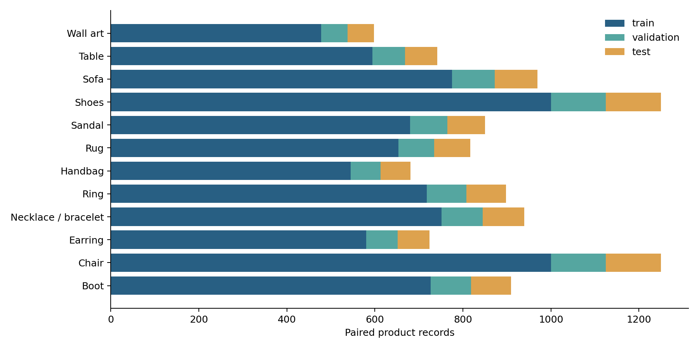
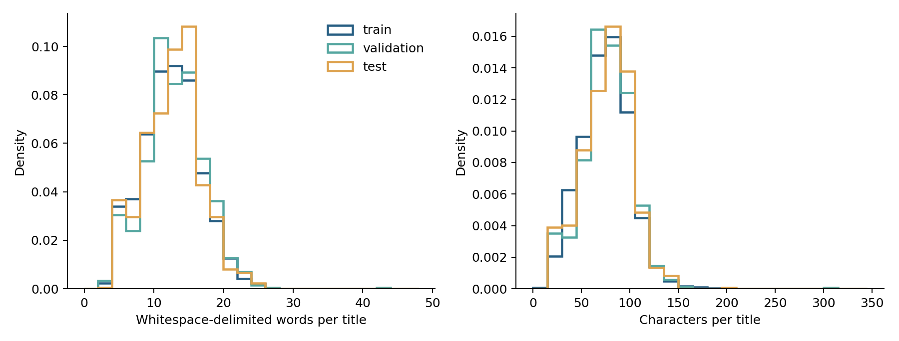
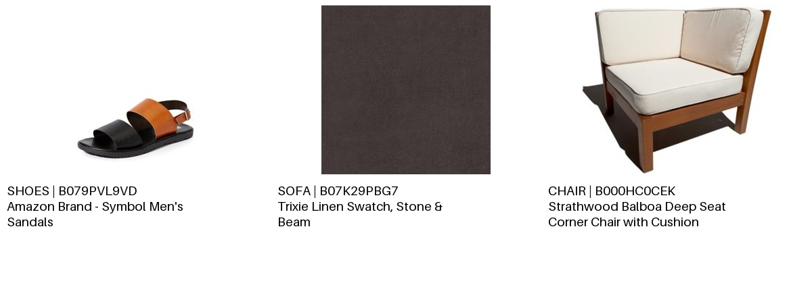

# A3 Dataset Proposal

**Group NNs | CO3133 | Semester 261 | 18 November 2026**

**Catalog product-type classification from product images and titles**

Ho Chi Minh City University of Technology, VNU-HCM. Faculty of Computer Science and Engineering. Instructor Lê Thành Sách.

Nguyễn Nhật Nam (2352778), Hồ Hồng Phúc Nguyên (2352824), Phan Quốc Đại Sơn (2353053).

**Decision pending.** This M1 package requests approval for the dataset, subset, target definition and experimental plan below. The main model experiments follow the approval decision. Submission time and the instructor's decision will be recorded in `a3_approval.md`.

## 1. Problem and research question

Product listings combine a photograph with a seller-provided title. Titles can be short, noisy or translated, while photographs can show several objects or visually similar products. We propose single-label classification of a listing into one of 12 native Amazon catalog product types using its main image and English-locale title. The prediction unit is one product item ID.

Our research question is whether image information adds value beyond a title-only classifier, and whether learned gating improves fusion when the modalities provide unequal or conflicting evidence. The target is the original catalog tag, including its documented semantic overlap. The evaluation will examine gains, losses and compute cost, with concrete examples of supporting and conflicting evidence.

| Component | Definition |
|---|---|
| Modality A | Native main product image, decoded to RGB |
| Modality B | Native item title with an English locale tag |
| Output | 12 logits, followed by argmax over the shared label map |
| Pairing key | Original `item_id` and its `main_image_id` |
| Primary metric | Macro-F1 over all 12 classes |
| Additional metrics | Accuracy, per-class precision/recall/F1, confusion matrix, runtime and parameter count |

## 2. Dataset source, snapshot and license

Amazon Berkeley Objects (ABO) provides product metadata and associated catalog photographs. We downloaded the complete official listing archive and image index on 18 November 2026, then downloaded native small images for the selected product types. Their longest dimension is at most 256 pixels. The source images and data are credited to Amazon.com under Creative Commons Attribution 4.0. The source documentation and full license are retained locally. [Official ABO dataset and download documentation](https://amazon-berkeley-objects.s3.us-east-1.amazonaws.com/index.html)

The snapshot is pinned by the archive/index SHA-256 values, source URLs and ETags in `results/a3/data/summary.json`. Individual image URLs, source ETags, byte counts and SHA-256 values are in `data/raw/abo/image_sources.jsonl`. These identify the actual downloaded files even if the hosting URLs later change.

<!-- pagebreak -->

## 3. Sample counts and subset rules

The **147,702 source records** yield **121,488 unique eligible English-title items**. The 12 chosen classes contain **19,904 eligible items** and **13,320 unique main images**. Removing 105 exact image/title/label duplicates and 569 records with conflicting labels on identical images leaves **19,230 clean pairs** in this scope.

The experiment contains **10,627 pairs and 12 classes**, exceeding the handbook defaults of five classes and about 5,000 pairs. Seed 42, alphabetical class iteration and a 1,250-per-class cap select CHAIR and SHOES subsets. All clean pairs from the other ten classes are retained. Broad source categories and the dominant phone-case category are outside the proposed scope.

| Native product type | Selected | Train | Validation | Test |
|---|---:|---:|---:|---:|
| BOOT | 909 | 727 | 91 | 91 |
| CHAIR | 1,250 | 1,000 | 125 | 125 |
| FINEEARRING | 724 | 580 | 72 | 72 |
| FINENECKLACEBRACELETANKLET | 939 | 751 | 94 | 94 |
| FINERING | 898 | 718 | 90 | 90 |
| HANDBAG | 681 | 545 | 68 | 68 |
| RUG | 817 | 653 | 82 | 82 |
| SANDAL | 850 | 680 | 85 | 85 |
| SHOES | 1,250 | 1,000 | 125 | 125 |
| SOFA | 969 | 775 | 97 | 97 |
| TABLE | 742 | 594 | 74 | 74 |
| WALL_ART | 598 | 478 | 60 | 60 |
| **Total** | **10,627** | **8,501** | **1,063** | **1,063** |



Each pair has one source product-type tag. The selected subset uses 8,739 distinct image IDs because several item variants can share a main photograph. Shared images and related variants are grouped for splitting. The largest-to-smallest selected class ratio is 2.09. The smallest test class contains 60 pairs, so per-class estimates will be interpreted with their sample sizes.

<!-- pagebreak -->

## 4. Multimodal EDA and missingness

Missingness was counted independently on raw records. Absence of an English title is a language-eligibility condition. Every raw record has title text in at least one language. The sequential cleaning exclusion counts use different denominators and are recorded separately.

| Population | Records/pairs | Missing any title | Missing main-image ID/file | No English title |
|---|---:|---:|---:|---:|
| All raw listings | 147,702 | 0 | 575 (0.3893%) | 24,968 (16.9043%) |
| Raw listings in the 12 source classes | 27,316 | 0 | 23 (0.0842%) | 6,924 (25.3478%) |
| Selected experiment pairs | 10,627 | 0 | 0 | 0 |

The selected titles contain 2 to 45 whitespace-delimited words, with median 12, 95th percentile 19 and 99th percentile 22. Character counts range from 11 to 321, with median 75. English locale tags can still accompany romanized or translated fragments. Locale filtering therefore establishes the selected source-language metadata, while text quality remains a documented limitation.



The image short side ranges from 40 to 256 pixels, with median 197. Width/height ratios range from 0.156 to 4.741. The planned resize preserves aspect ratio and pads to a square so elongated products remain visible. All 13,320 downloaded main images passed decoding and minimum-size checks during preparation.

The image-geometry plot is saved in `results/a3/eda/a3_image_geometry.png`.

<!-- pagebreak -->

## 5. Pair quality, annotation review and leakage control

For all 10,627 selected records, the audit re-opened the source archive at the recorded file and line, and checked the item ID, image ID, source product type, title text and title locale. All selected pairs matched the native record. The modalities originate from the same listing.

Visual inspection covered 36 pairs, comprising two fixed-seed random pairs per class and 12 additional title-flag candidates. All 36 depicted a compatible product family. Nine showed native SHOES labels on sandals, and one showed a fabric swatch under SOFA. These findings concern catalog-label breadth. The visible product families remained compatible with their titles. Fine attributes such as exact size, material and color were not exhaustively verified. The mixed review sample supports qualitative observations, and its composition prevents treating it as an unbiased population error-rate estimate.

Across the full selected subset, title-based checks flag 45 SHOES titles mentioning boots, 97 mentioning sandals, and 76 CHAIR/SOFA titles mentioning accessory-related words. The 218 flagged pairs are review candidates. A complete chair described as having cushions can also trigger the accessory-word rule. We retain native labels for the proposed catalog-tag task, preserve review notes and request approval of this target definition.



The cleaning pipeline normalizes HTML entities, Unicode and whitespace, validates decoding and dimensions, removes exact image/title/label duplicates, and excludes identical decoded images with conflicting labels. Exclusion reasons and native source locations are saved in `data/processed/abo/excluded.csv`.

Splits use connected groups formed by shared item/image identity, identical decoded pixels, identical case-normalized titles, shared brand/model identifiers and perceptual-hash Hamming distance at most four. Groups are computed on the clean class-scope catalog before subset selection, retaining connections through unselected records. Groups remain intact during the approximate 80/10/10 assignment. The result is **8,501 train, 1,063 validation and 1,063 test pairs** with seed 42.

The selected subset has 5,286 groups. The largest contains 1,211 pairs, or 11.40%, and includes visually similar footwear. Conservative links can join distinct products. This will be considered when interpreting performance under the grouped split. Checks found zero cross-split overlap in item IDs, group IDs, image IDs, decoded-pixel hashes and normalized titles. All main models will use the same saved manifests. Validation controls tuning and checkpoint selection. Test predictions are reserved for the fixed final configurations.

<!-- pagebreak -->

## 6. Planned encoders, fusion and training

The planned image encoder is ResNet-18 initialized with Torchvision `IMAGENET1K_V1` weights. Removing the ImageNet classifier yields a 512-dimensional representation. The planned text encoder is `distilbert/distilbert-base-uncased`, whose six-layer configuration uses hidden size 768. Masked mean pooling produces a 768-dimensional title representation. Exact library versions, downloaded weight hashes and the Hugging Face revision will be recorded with the first approved runs. [Torchvision ResNet-18 documentation](https://docs.pytorch.org/vision/stable/models/generated/torchvision.models.resnet18.html) and [DistilBERT model configuration](https://huggingface.co/distilbert/distilbert-base-uncased/raw/main/config.json)

| Required model | Inputs | Planned representation and classifier |
|---|---|---|
| Unimodal A | Image | ResNet-18 pooled 512-vector and a 12-class head |
| Unimodal B | Title | DistilBERT pooled 768-vector and a 12-class head |
| Simple fusion | Image and title | Concatenate the 512- and 768-vectors, followed by a 256-unit MLP and class head |
| Improved fusion | Image and title | Project each vector to 256 units, learn a 256-dimensional sigmoid gate from both projected vectors, blend the two representations and classify |

Learned gating follows the principle of assigning data-dependent influence to each modality. The planned operation is `h = g * h_image + (1 - g) * h_text`, with a sigmoid gate. The gate design and prediction head will be implemented by the group using library-provided encoders. [Gated Multimodal Units for Information Fusion](https://arxiv.org/abs/1702.01992)

Images will be converted to RGB, resized with aspect ratio preserved, padded with white to 224 by 224 pixels, and normalized with the ImageNet mean and standard deviation. Mild color jitter is planned for training. Titles retain their natural product names and use the pretrained WordPiece tokenizer with a planned maximum length of 96 tokens. The actual truncation rate will be measured after tokenizer preparation. Image tensors have shape `[B, 3, 224, 224]`, title IDs and attention masks `[B, 96]`, and labels `[B]`. Training uses complete paired records. Missing-modality masking will be used for explicit ablation evaluation.

The planned setup uses batch size 32, at most 20 epochs, two frozen-encoder warm-up epochs, then fine-tuning of the final ResNet stage and final two DistilBERT layers. AdamW uses learning rates 0.001 for heads and 0.00002 for unfrozen encoder parameters, weight decay 0.01 and cosine scheduling. Fusion-head dropout is 0.2, gradient clipping is 1.0 and early-stopping patience is four epochs. The best validation macro-F1 checkpoint is retained. Main comparisons use seeds 42, 43 and 44 on the same data split.

Each unimodal model minimizes cross-entropy for its modality-specific prediction. Each fusion model minimizes cross-entropy for its fused prediction, with no additional auxiliary-loss term in the main comparison. Accuracy and macro-F1 are reported for every model, with per-class results and mean and standard deviation across completed seeds.

## 7. Planned controlled experiments

The main comparison tests whether the fused models improve over the unimodal models under fixed splits, encoder initializations, preprocessing, metrics and checkpoint rules. A controlled ablation replaces the learned gate with a fixed 0.5 blend while keeping projections, training policy and data fixed. Separate inference ablations mask the image or text representation in the improved model to measure dependence on each modality. The gate comparison uses validation-selected settings and the same three seeds.

Results will include qualitative cases where fusion succeeds while a unimodal model fails, where the modalities disagree, and where fusion worsens a previously correct prediction. Error analysis will distinguish taxonomy overlap, text noise, ambiguous photographs and repeated product variants. Conclusions will report the size and variability of differences together with training and inference costs.

<!-- pagebreak -->

## 8. Compute estimate and feasibility

The planned training resource is one CUDA GPU with at least 16 GB memory. Availability and actual throughput remain to be confirmed. The following figures are **planning estimates**, calculated for 8,501 training pairs and 20 epochs using assumed training throughputs. They are separate from measured EDA results.

| Configuration | Assumed pairs/second | Estimated hours/run | Three seeds |
|---|---:|---:|---:|
| Image-only | 35 | 1.35 | 4.05 |
| Title-only | 60 | 0.79 | 2.36 |
| Concatenation fusion | 25 | 1.89 | 5.67 |
| Learned-gate fusion | 25 | 1.89 | 5.67 |
| Fixed-gate ablation | 25 | 1.89 | 5.67 |

The formula is `8,501 * 20 / assumed_pairs_per_second / 3,600`. The core models and one trained fusion ablation total about 23.4 GPU hours for three seeds. A 25% contingency gives about 29.3 hours, with a reserved budget of 32 GPU hours for loading, validation, inference ablations and analysis. A short throughput/memory pilot after approval will replace these assumptions with measured figures and determine a feasible batch size. The existing 1,250-per-class cap is the declared subset rule.

## 9. Reproducibility and approval record

The repository branch is `a3_eda`. Run the commands below from the repository root with Python 3.12+ and the pinned M1 dependencies. Raw data are under `data/raw/abo/`, processed pairs under `data/processed/abo/`, and audit evidence under `results/a3/data/` and `results/a3/eda/`.

```bash
python -m pip install -r a3_requirements.txt
python scripts/a3_download_abo.py
python scripts/a3_prepare_abo.py --download-images --workers 16
python scripts/a3_eda.py
```

The selected-pairs manifest SHA-256 is `dc5c98e0605297c5517da6e9b145f6c50693b68d8d898d6f5d66eed8049e5048`. All split and source hashes are recorded in the JSON evidence. Six preparation CSV files were byte-identical after an offline rerun. Source checking for every selected pair and saved visual-review notes accompany the proposal.

M1 is dated 18 November 2026. M2 on 25 November requires quantitative unimodal and simple-fusion results. M3 on 2 December adds improved fusion, ablation and the final deliverables. Handbook deadlines are 23:59 GMT+7. The instructor's decision and written conditions will be attached to `a3_approval.md` and reflected in the implementation plan.

## 10. AI usage disclosure

OpenAI Codex assisted Nguyễn Nhật Nam with acquisition, cleaning/EDA, visual review, experiment planning and proposal drafting. EDA values come from source-file runs. Codex checked the 36 review images, source correspondence, split isolation, reproducibility and the exported PDF. The group is responsible for final review and understanding. Prompts, affected files and verification records are in `AI_USAGE.md`, with summaries on the landing and assignment pages.

## References

[ABO documentation](https://amazon-berkeley-objects.s3.us-east-1.amazonaws.com/index.html), [ResNet-18 documentation](https://docs.pytorch.org/vision/stable/models/generated/torchvision.models.resnet18.html), [DistilBERT model card](https://huggingface.co/distilbert/distilbert-base-uncased), [DistilBERT configuration](https://huggingface.co/distilbert/distilbert-base-uncased/raw/main/config.json), and [Arevalo et al., GMU, 2017](https://arxiv.org/abs/1702.01992).

Course Project Handbook, revision 14 September 2026, Sections 7.6 and 27-31. Local source `handbook-ene-v2.pdf`.
